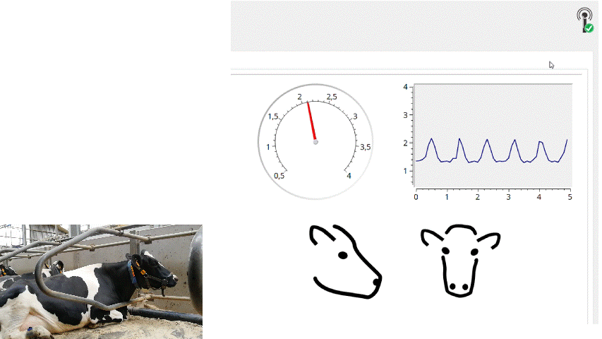

# Practical: Cow behaviour classification

In this practical you use accelerometer and pressure data of dairy cows (RumiWatch sensor) to train **Random Forest** and **XGBoost** models that predict the cow's behaviour (other activity, rumination, ingestive behaviour). You learn how to build features from raw sensor data, how to recognise and avoid data leakage and overfitting (cross-validation by cow, validation curves, tuning grids), and how to choose a threshold with ROC and precision-recall curves. You train on two cows, save a complete model that turns raw sensor data into behaviours, and test it once on a third cow that the model has never seen.



You work in **Python** in a **GitHub Codespace**: a ready-made computer in your browser with everything installed (Python 3.12, all packages, VS Code and Jupyter). **You do not have to install anything.**

---

## Start (once, ± 5 minutes)

### Step 1 – GitHub account
Make a free account on <https://github.com> (or log in).

### Step 2 – Make your own **private** copy of this repository
1. Open the page of this repository on GitHub.
2. Click the green button **Use this template** (top right) → **Create a new repository**.
3. Choose yourself as *Owner*, give it a name (e.g. `cow_behaviour_practical`) and select **Private**.
4. Click **Create repository**.

> [!WARNING]
> Do **not** use *Fork*. A fork of a public repository is public, so everyone could see your work. Always select **Private**.

### Step 3 – Open your Codespace
1. In **your new repository**: click the green button **Code** → tab **Codespaces** → **Create codespace on main**.
2. Wait 3–5 minutes the first time. VS Code opens in your browser and installs the packages (progress is shown at the bottom). **Wait until it is finished.**

### Step 4 – Open the notebook and select the kernel
1. In the file explorer on the left: open the folder `notebooks_code` and click on **`01_cow_behaviour.ipynb`**.
2. Top right in the notebook, click **Select Kernel** → **Python Environments** → choose **Python 3.12.x** (`/usr/local/bin/python`).

You are ready to start! 
---

## Working in the notebook

| What you see | What you do |
|---|---|
| **Blue box** = a task | Write your code in the code cell below it, between `YOUR CODE STARTS HERE` and `YOUR CODE ENDS HERE`. |
| **Grey box** = hints or background | Click to open the hints. Try yourself first. |
| **Your answer** | Double-click the cell and type your answer under the line. Press Shift+Enter to finish. |
| **Check cell** | Lists what it checks and why. Green = your result has the right form (not that your model is good), orange = something to fix. |

**Shortcuts:** `Shift + Enter` = run cell and go to the next · `Ctrl + S` = save.

> [!TIP]
> Run the cells **from top to bottom**. If something behaves strangely: *Restart* (top of the notebook) and *Run All*.

- Use exactly the variable names given in the tasks (e.g. `X_train`, `rf`, `y_pred_rf`): later cells use them.
- Some cells (feature extraction, cross-validation, tuning grids) take a few minutes. Running the whole notebook takes about 20 to 30 minutes. That is normal.
- Helper functions (the check functions) are in `functions/practical_tools.py`. You do not have to change this file.

---

## Submitting

At the end, make sure the notebook runs **from start to finish without errors** (*Restart* → *Run All*).

1. **Export to HTML:** in the notebook toolbar click the `...` (More actions) → **Export** → **HTML**.
2. **Download both files:** right-click the file in the explorer on the left → **Download**:
   - `notebooks_code/01_cow_behaviour.ipynb`
   - the exported `.html` file
3. Rename them `name_firstname_cow_behaviour.ipynb` and `name_firstname_cow_behaviour.html`.
4. Upload both on **Ufora**.

---

## Use GitHub Copilot

You are allowed to use **GitHub Copilot**, the AI assistant built into VS Code. It is installed in the Codespace.

- **It is free for every GitHub account** within a monthly limit of code suggestions and chat messages (the limits can change). Students can also get Copilot Pro for free through [GitHub Education](https://education.github.com/students).
- Click the Copilot icon at the top of VS Code to open the chat. Sign in with your GitHub account if asked.
- Good uses: ask it to **explain** an error message or a line of code, to explain a concept (e.g. standardization, confusion matrix), or to suggest how to start a task.
- Select a cell or error, then ask a specific question, for example *"Why do I get a shape mismatch in this cell?"*

> [!IMPORTANT]
> You are responsible for your answers. Make sure you understand every line you submit, and check the result with the check cells and your own evaluation. Copilot can make mistakes.

---

## Good to know about Codespaces

- Your Codespace **stops automatically** after 30 minutes of inactivity. Your files are kept. Reopen it via your repository → **Code** → **Codespaces** (or <https://github.com/codespaces>).
- **Stop it yourself when you are done** (<https://github.com/codespaces> → `...` → *Stop codespace*), to save your free hours.
- A free GitHub account has a monthly amount of free Codespaces hours (at the time of writing 120 core-hours = ± 30 hours on the 4-core machine used here). This practical needs far less.
- **Commit and push your work regularly** to your own private repository (Source Control icon on the left, type a message, then **Commit** and **Sync Changes**).

> [!IMPORTANT]
> A Codespace that is not used for 30 days is **deleted**. Work that you committed and pushed stays in your repository. Always submit by downloading your notebook (see Submitting).

---

## Problems?

| Problem | Solution |
|---|---|
| Packages are missing / `ModuleNotFoundError` | Wait until the set-up at the bottom of VS Code is finished. Still missing? Open a terminal (menu *Terminal → New Terminal*) and run `pip install -r requirements.txt`. |
| No kernel / wrong Python version | Top right **Select Kernel** → **Python Environments** → Python 3.12. |
| Export to HTML does not work | In a terminal: `pip install nbconvert`, then try again. |
| Out of memory / kernel crashed | The data of three cows is large (about 2 GB). Restart the kernel and run the cells again from the top. Make sure your Codespace runs on the 4-core machine with 16 GB memory (repository page, Codespaces menu, `...`, *Change machine type*). Close other notebooks. |
| Something else | Ask the teacher. |

---

## Alternative: work on your own computer

Only if you prefer not to use Codespaces.

1. Install **Python 3.12** (<https://www.python.org/downloads/>) and **VS Code** (<https://code.visualstudio.com/>) with the extensions *Python* and *Jupyter*.
2. Download this repository (green **Code** button → *Download ZIP*) and unzip it. In VS Code: *File → Open Folder* and select the folder.
3. Open a terminal in VS Code and create the environment (Windows):

   ```bash
   py -3.12 -m venv .venv
   .venv\Scripts\activate
   pip install -r requirements.txt ipykernel nbconvert
   ```

   macOS / Linux: `python3.12 -m venv .venv`, `source .venv/bin/activate`, then the same `pip install`.
4. Open `notebooks_code/01_cow_behaviour.ipynb`, click **Select Kernel** → **Python Environments** → `.venv`.
5. Continue as described above.

---

## What is in this repository

```
├── data/raw/           # Sensor data for this practical
├── notebooks_code/     # The notebook you work in (01_cow_behaviour.ipynb)
├── functions/          # Helper tools (practical_tools.py)
├── docs/               # Images
├── requirements.txt    # Python packages
└── .devcontainer/      # Settings of the Codespace (do not change)
```
